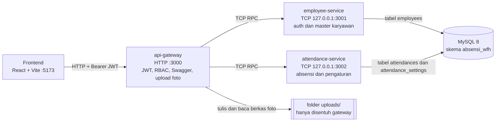
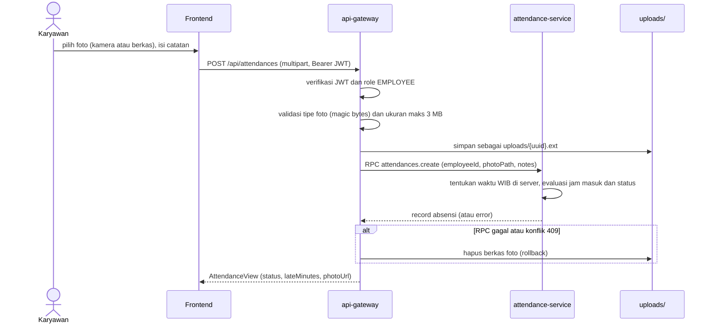

# Absensi WFH & Monitoring Karyawan

Aplikasi web untuk mencatat kehadiran karyawan yang bekerja dari rumah (WFH) dan memantaunya oleh tim HRD.

- **Karyawan** login, lalu absen satu kali per hari dengan foto bukti (dari kamera atau unggah berkas). Tanggal dan jam dicatat oleh server, bukan oleh perangkat karyawan.
- **Admin HRD** mengelola master karyawan, mengatur jam masuk dan toleransi keterlambatan, memantau absensi (hanya lihat), melihat kartu ringkasan harian, memfilter berdasarkan status, dan mengekspor laporan ke CSV.

Zona waktu aplikasi: **Asia/Jakarta (WIB)**.

## Daftar isi

1. [Arsitektur](#arsitektur)
2. [Tech stack](#tech-stack)
3. [Prasyarat](#prasyarat)
4. [Menjalankan secara lokal dari nol](#menjalankan-secara-lokal-dari-nol)
5. [Akun demo](#akun-demo)
6. [Daftar endpoint](#daftar-endpoint)
7. [Keputusan desain dan alasannya](#keputusan-desain-dan-alasannya)
8. [Batasan yang diketahui dan rencana pengembangan](#batasan-yang-diketahui-dan-rencana-pengembangan)
9. [Skenario demo 5 menit](#skenario-demo-5-menit)
10. [Dokumen terkait](#dokumen-terkait)

## Arsitektur

Frontend hanya berbicara dengan **api-gateway** lewat HTTP. Dua service di belakangnya berkomunikasi lewat TCP (NestJS Microservices) dan hanya bind ke `127.0.0.1`, sehingga tidak terjangkau dari luar mesin.



Alur absen (`POST /api/attendances`), disusun dari handoff Fase 5B dan kontrak Fase 5.5:



Pembagian kepemilikan data:

| Komponen | Tanggung jawab | Tabel |
|---|---|---|
| `apps/api-gateway` | Satu-satunya pintu publik: CORS, helmet, validasi DTO, JwtAuthGuard dan RolesGuard, Swagger, upload dan streaming foto, orkestrasi lintas service (pencarian nama, summary, export) | tidak ada |
| `apps/employee-service` | Login (bcrypt, penerbitan JWT), validasi token, master karyawan | `employees` |
| `apps/attendance-service` | Transaksi absensi, status terlambat, pengaturan jam masuk, statistik harian | `attendances`, `attendance_settings` |
| `libs/common` | Enum, DTO, interface, utilitas waktu WIB, nama pola RPC, `AllRpcExceptionsFilter`, helper `sendRpc` | tidak ada |

## Tech stack

| Lapisan | Teknologi |
|---|---|
| Backend | TypeScript, NestJS 10 (monorepo, transport TCP), TypeORM, MySQL 8 |
| Auth | JWT (`@nestjs/jwt`, `passport-jwt`), password di-hash dengan bcrypt, role `EMPLOYEE` dan `ADMIN_HRD` |
| Validasi | class-validator dan class-transformer (`ValidationPipe` dengan `whitelist: true`) |
| Keamanan HTTP | helmet, CORS terbatas ke origin frontend (`FRONTEND_URL`) |
| Dokumentasi API | Swagger (`@nestjs/swagger`) di `/api/docs` |
| Frontend | React 18, Vite 5, TypeScript, Tailwind CSS 3, React Router 6, Axios, Radix UI (Dialog), lucide-react |
| Infrastruktur lokal | Docker Compose untuk MySQL saja |

## Prasyarat

- **Node.js 20 LTS** dan npm. Versi ini disimpulkan dari `@types/node ^20` di `backend/package.json`; batas versi minimum yang pasti *perlu diverifikasi*.
- **Docker** dan Docker Compose (untuk MySQL).
- Port yang harus bebas: `3306` (MySQL), `3000` (gateway), `3001` dan `3002` (TCP internal), `5173` (frontend).

## Menjalankan secara lokal dari nol

Seluruh perintah dijalankan dari root repositori kecuali disebutkan lain.

### 1. Jalankan MySQL

```bash
docker compose up -d
docker compose ps        # tunggu sampai absensi-mysql berstatus healthy
```

`docker-compose.yml` saat ini hanya berisi service `mysql` (image `mysql:8.0`, container `absensi-mysql`). Database `absensi_wfh`, user `absensi_user` dan zona waktu `+07:00` sudah diatur lewat compose.

### 2. Siapkan environment backend

```bash
cd backend
cp .env.example .env     # Windows PowerShell: Copy-Item .env.example .env
npm install
```

Variabel penting di `backend/.env` (nilai bawaan dari `.env.example`):

| Variabel | Bawaan | Keterangan |
|---|---|---|
| `GATEWAY_PORT` | `3000` | Port HTTP gateway |
| `FRONTEND_URL` | `http://localhost:5173` | Origin yang diizinkan CORS |
| `RPC_TIMEOUT_MS` | `5000` | Batas waktu panggilan RPC gateway ke service |
| `EMPLOYEE_SERVICE_HOST` / `_PORT` | `127.0.0.1` / `3001` | Alamat TCP employee-service |
| `ATTENDANCE_SERVICE_HOST` / `_PORT` | `127.0.0.1` / `3002` | Alamat TCP attendance-service |
| `UPLOAD_DIR` | `./uploads` | Folder foto bukti (relatif terhadap direktori tempat perintah dijalankan, yaitu `backend/`) |
| `DB_HOST`, `DB_PORT`, `DB_NAME`, `DB_USER`, `DB_PASSWORD` | `127.0.0.1`, `3306`, `absensi_wfh`, `absensi_user`, `absensi_pass` | Sesuai `docker-compose.yml` |
| `DB_SYNCHRONIZE` | `true` | Skema dibuat otomatis oleh TypeORM |
| `JWT_SECRET` | contoh placeholder | **Ganti** dengan string acak minimal 32 karakter. Secret yang sama dipakai gateway (verifikasi) dan employee-service (penandatanganan) |
| `JWT_EXPIRES_IN_SECONDS` | `28800` | Masa berlaku token (8 jam) |
| `BCRYPT_ROUNDS` | `10` | Biaya hash bcrypt |

Folder `backend/uploads/` ikut di repo lewat `.gitkeep` (lihat `.gitignore`). Jika tidak ada di salinan Anda, buat manual dengan `mkdir uploads`; apakah gateway membuatnya otomatis *perlu diverifikasi*.

### 3. Jalankan tiga service backend

Cara paling singkat (satu terminal, tiga proses via `concurrently`):

```bash
npm run start:dev
```

Atau satu terminal per service:

```bash
npm run start:employee     # TCP :3001
npm run start:attendance   # TCP :3002
npm run start:gateway      # HTTP :3000
```

Saat service pertama kali jalan, TypeORM membuat tabel (`DB_SYNCHRONIZE=true`). Pastikan log menampilkan `api-gateway listening on :3000`.

### 4. Isi data demo (seeder)

Buka terminal baru, lalu:

```bash
cd backend
npm run seed
```

Seeder (`apps/employee-service/src/database/seed.ts`) membuat dua akun demo dan idempoten, artinya aman dijalankan ulang. Jalankan **setelah** tabel terbentuk (langkah 3). Jika seeder mengeluh tabel belum ada, tunggu service selesai start lalu ulangi.

Baris tunggal `attendance_settings` (`id = 1`) menurut spesifikasi Fase 5.5 di-seed otomatis oleh attendance-service. Nilai bawaannya mengikuti contoh respons di kontrak API (`earliestCheckIn 00:00`, `defaultCutoffTime 08:00`, `toleranceMinutes 15`, `requireNoteWhenLate false`, `workingDays` semua hari); mekanisme dan nilai persisnya *perlu diverifikasi* di `attendance-settings.service.ts`.

### 5. Jalankan frontend

```bash
cd ../frontend
npm install
npm run dev
```

Buka <http://localhost:5173>. Frontend memanggil `http://localhost:3000/api` secara bawaan. Untuk mengubahnya, buat `frontend/.env`:

```
VITE_API_URL=http://localhost:3000/api
```

### 6. Cek cepat

- `GET http://localhost:3000/api/time` mengembalikan waktu server (endpoint publik).
- Swagger: <http://localhost:3000/api/docs>.
- `api.http` di root berisi kumpulan request siap pakai (ekstensi VS Code *REST Client*).

### Mereset data

```bash
docker compose down -v     # menghapus volume MySQL, lalu ulangi dari langkah 1
```

Hapus juga isi `backend/uploads/` (kecuali `.gitkeep`) agar tidak ada foto yatim.

### Build produksi (opsional)

```bash
cd backend && npm run build
npm run start:prod:employee & npm run start:prod:attendance & npm run start:prod:gateway
cd ../frontend && npm run build
```

Belum ada Dockerfile untuk aplikasi Node dan frontend (lihat [Batasan](#batasan-yang-diketahui-dan-rencana-pengembangan)).

## Akun demo

| Peran | Email | Kata sandi |
|---|---|---|
| Admin HRD (`ADMIN_HRD`) | `admin@company.test` | `Admin123!` |
| Karyawan (`EMPLOYEE`) | `budi@company.test` | `Karyawan123!` |

Akun ini hanya untuk pengujian. Hapus atau ganti sebelum dipakai di lingkungan nyata.

## Daftar endpoint

Semua path berawalan `/api`. Autentikasi memakai header `Authorization: Bearer <accessToken>`. Format error standar: `{ "statusCode": number, "message": string | string[], "error"?: string }`.

| Method | Path | Role | Fungsi |
|---|---|---|---|
| GET | `/time` | Publik | Waktu server (WIB) untuk sinkronisasi jam di frontend |
| POST | `/auth/login` | Publik | Login, mengembalikan `accessToken`, `expiresIn`, `user` |
| GET | `/auth/me` | Semua user login | Profil user dari token |
| GET | `/employees` | ADMIN_HRD | Daftar karyawan (paginasi, `search`, `role`, `isActive`) |
| POST | `/employees` | ADMIN_HRD | Tambah karyawan |
| GET | `/employees/:id` | ADMIN_HRD | Detail karyawan |
| PATCH | `/employees/:id` | ADMIN_HRD | Ubah karyawan (parsial) |
| DELETE | `/employees/:id` | ADMIN_HRD | Soft delete (`isActive = false`) |
| POST | `/attendances` | EMPLOYEE | Absen: multipart `photo` (wajib) dan `notes` (opsional, maks 500 karakter) |
| GET | `/attendances/today` | EMPLOYEE | Absensi hari ini, `null` jika belum absen |
| GET | `/attendances/my` dan `/attendances/me` | EMPLOYEE | Riwayat absensi sendiri (paginasi, filter tanggal) |
| GET | `/attendances/settings` | Semua user login | Baca pengaturan jam masuk |
| PATCH | `/attendances/settings` | ADMIN_HRD | Ubah pengaturan (parsial) |
| GET | `/attendances/summary` | ADMIN_HRD | Ringkasan harian (`?date=YYYY-MM-DD`, bawaan hari ini WIB) |
| GET | `/attendances/export` | ADMIN_HRD | Unduh CSV sesuai filter, maks 5.000 baris |
| GET | `/attendances` | ADMIN_HRD | Daftar absensi semua karyawan dengan filter dan paginasi |
| GET | `/attendances/:id/photo` | Pemilik absen atau ADMIN_HRD | Stream biner foto (`image/jpeg`, `image/png`, `image/webp`) |

Parameter query untuk `GET /attendances` dan `/attendances/export`:

| Parameter | Keterangan |
|---|---|
| `dateFrom` atau `date_from` | `YYYY-MM-DD` |
| `dateTo` atau `date_to` | `YYYY-MM-DD` |
| `search` atau `employee_name` | Cari nama atau NIK |
| `employeeId` | UUID satu karyawan |
| `status` | `ON_TIME` atau `LATE` |
| `page`, `limit` | Hanya `GET /attendances` (`limit` 1 sampai 100, bawaan 10). Export tidak memakai paginasi |

Catatan perilaku:

- Pengaturan yang bisa diubah lewat `PATCH /attendances/settings`: `earliestCheckIn` (HH:mm), `defaultCutoffTime` (HH:mm), `toleranceMinutes` (0 sampai 120), `requireNoteWhenLate` (boolean), `workingDays` (angka 0 = Minggu sampai 6 = Sabtu, minimal 1 hari, tanpa duplikat).
- Respons export berupa `text/csv; charset=utf-8` dengan header `Content-Disposition: attachment; filename="rekap-absensi-wfh-YYYY-MM-DD.csv"` dan `X-Export-Truncated: true|false` (bernilai `true` jika data yang cocok melebihi 5.000 baris). Header ini diekspos lewat CORS agar bisa dibaca frontend.
- `summary` menghitung `totalEmployees` hanya dari karyawan **aktif** ber-role `EMPLOYEE`. Hasilnya memuat `presentCount`, `onTimeCount`, `lateCount`, `absentCount`, dan `absentEmployees`.
- Setiap record absensi memuat `status` (`ON_TIME` atau `LATE`) dan `lateMinutes` (0 jika tepat waktu).
- Kolom CSV mengikuti spesifikasi Fase 5.5: `NIK, Nama Karyawan, Tanggal, Jam (WIB), Status, Keterlambatan (Menit), Catatan`, diawali UTF-8 BOM agar terbaca benar di Excel. Isi persisnya *perlu diverifikasi* terhadap `utils/csv.util.ts`.

## Keputusan desain dan alasannya

**Waktu absen selalu dari server.** Gateway tidak menerima waktu dari klien. `attendance-service` membangkitkan `checkInAt` dan menurunkan `attendanceDate` (tanggal kalender WIB) di sisi server. Jam digital di halaman karyawan hanya tampilan yang disinkronkan ke `GET /api/time` (koreksi setengah RTT, sinkron ulang tiap 5 menit); stempel pada pratinjau foto berlabel "Pratinjau" dan bukan waktu resmi. Alasannya: klien mudah dimanipulasi, sedangkan absensi harus bisa dipertanggungjawabkan.

**Status terlambat disimpan saat absen.** Kolom `status` dan `late_minutes` dihitung dan ditulis ketika absen dibuat, tidak dihitung ulang saat pengaturan berubah. Alasannya: riwayat harus stabil. Jika HRD mengubah jam masuk dari 08:00 ke 09:00, absensi kemarin tidak berubah status. Konsekuensinya, laporan lama mencerminkan aturan yang berlaku pada hari itu. `lateMinutes` dihitung dari batas jam masuk dasar (`defaultCutoffTime`), sedangkan penentuan `LATE` memakai batas dasar ditambah `toleranceMinutes`.

**Pengaturan hanya berlaku ke depan.** Akibat keputusan di atas, perubahan `attendance_settings` hanya memengaruhi absensi yang dibuat sesudahnya. Tidak ada fitur "hitung ulang" untuk data lama.

**Tanpa foreign key lintas service.** `attendances.employee_id` hanya berisi UUID tanpa FK fisik ke `employees.id`, karena tabel dimiliki service yang berbeda dan harus bisa berkembang atau dipindah ke database sendiri tanpa terikat constraint silang. Konsekuensinya, penggabungan data dilakukan di gateway. Untuk pencarian nama, gateway memanggil `employees.searchIds` (mencocokkan nama atau NIK) lalu meneruskan `employeeIds` ke `attendances.findAll`, sehingga filter tanggal, status, dan paginasi dihitung di level database. Nama dan NIK diambil setelah paginasi lewat `employees.findBriefs(ids)`. Catatan: `searchIds` saat ini mencocokkan semua role, belum dibatasi ke `EMPLOYEE`. Diagram relasi ada di [`docs/erd.md`](docs/erd.md).

**Satu instance MySQL, satu skema.** Kedua service memakai `DB_NAME=absensi_wfh` yang sama, tetapi masing-masing hanya menyentuh tabelnya sendiri. Ini pilihan paling sederhana untuk lingkungan lokal.

**Foto lewat gateway, bukan lewat service.** Hanya `api-gateway` yang membaca dan menulis folder `uploads/`. Buffer gambar tidak dikirim ke `attendance-service`; service hanya menerima `photoPath`. `photoPath` bersifat internal dan tidak dikembalikan ke klien: klien menerima `photoUrl` berupa `/api/attendances/:id/photo`. Endpoint itu memeriksa pemilik atau role HRD, mengirim `Cache-Control: private, no-store`, dan mencegah path traversal dengan `path.basename`. Di frontend, foto diambil sebagai blob dengan header Bearer lalu ditampilkan lewat object URL (`AuthedImage`, `useProtectedImage`), sehingga foto tidak pernah bisa dibuka lewat URL polos tanpa token.

**Validasi foto di server.** Gateway memeriksa tipe berkas dari isi (magic bytes) untuk JPG, PNG, dan WebP, serta membatasi ukuran maksimal 3 MB (`MAX_PHOTO_BYTES`, juga diterapkan di multer). Nama berkas dibuat ulang sebagai UUID. Jika panggilan RPC gagal atau terjadi konflik 409, berkas yang sudah ditulis langsung dihapus agar tidak ada berkas yatim.

**Deteksi foto duplikat (SHA-256).** Tabel `attendances` menyimpan `photo_hash` (SHA-256 isi foto, heksadesimal, diindeks tetapi tidak unik; `NULL` untuk data lama). Tujuannya mencegah foto yang sama dipakai berulang. Cakupan pemeriksaan (per karyawan atau global), kode HTTP penolakan, dan tempat hash dihitung *perlu diverifikasi*, karena kodenya tidak termasuk dalam berkas yang ditempel.

**Satu absen per karyawan per hari.** Dijamin constraint `UNIQUE (employee_id, attendance_date)` di database; pelanggaran menghasilkan 409 yang ditampilkan frontend sebagai pesan jelas.

**Soft delete karyawan.** `DELETE /employees/:id` hanya mengubah `is_active` menjadi `false`. Riwayat absensi tetap utuh, dan akun bisa diaktifkan lagi lewat menu ubah. Akun nonaktif tidak boleh login; implementasi pemeriksaannya ada di `auth.service.ts` (tidak terlihat di berkas yang ditempel, *perlu diverifikasi* lewat uji di bagian skenario demo). Di frontend, tombol nonaktifkan dan perubahan role untuk akun sendiri dikunci.

**HRD view-only untuk absensi.** Satu-satunya endpoint tulis di `attendances` untuk data absensi adalah `POST /attendances` yang hanya untuk `EMPLOYEE`. Untuk `ADMIN_HRD` hanya tersedia endpoint baca (`list`, `summary`, `export`, `photo`) dan pengaturan. Tidak ada ubah atau hapus absensi. Alasannya: bukti kehadiran tidak boleh bisa diedit oleh pihak yang memonitornya.

**TCP internal hanya di localhost.** `employee-service` dan `attendance-service` bind ke `127.0.0.1` secara bawaan (host dan port dibaca dari environment), sehingga satu-satunya jalur masuk dari luar adalah gateway yang menerapkan JWT dan RBAC.

**Format error terpusat.** `AllRpcExceptionsFilter` di `libs/common` mengubah error service menjadi respons HTTP dengan bentuk standar, sehingga frontend cukup menangani satu format.

## Batasan yang diketahui dan rencana pengembangan

- **Tanpa check-out.** Aplikasi hanya mencatat jam masuk, tidak ada jam pulang atau durasi kerja. Pengembangan: tambah kolom `check_out_at` dan aturan durasi minimum.
- **Tanpa jadwal shift, izin, dan cuti.** Hanya ada satu aturan jam masuk global plus `workingDays`. Hari libur nasional, shift, dan izin atau cuti belum dimodelkan, sehingga karyawan yang izin akan tampil sebagai "Belum Absen" pada kartu ringkasan. Spesifikasi awal Fase 5.5 menyebut *override* jam masuk per hari (`customDayCutoff`), tetapi field itu tidak ada di entity, DTO, maupun kontrak API, jadi **belum diimplementasikan**.
- **Isi foto tidak diverifikasi otomatis.** Server memeriksa tipe berkas, ukuran, dan duplikat, tetapi tidak memeriksa apakah foto benar-benar menampilkan karyawan sedang bekerja di rumah. Pengembangan: deteksi wajah dan liveness (anti-foto-dari-layar), serta pemeriksaan metadata.
- **Kamera hanya berjalan di `localhost` atau HTTPS.** Browser mensyaratkan konteks aman untuk akses kamera. Jika frontend diakses lewat HTTP dari alamat IP jaringan, ambil foto dari kamera tidak tersedia dan karyawan perlu memakai unggah berkas. Untuk produksi, layani frontend lewat HTTPS.
- **Peran admin tingkat atas belum ada.** Semua `ADMIN_HRD` setara: bisa menambah dan mengubah admin lain serta mengubah pengaturan. Frontend mengunci pengubahan role dan penonaktifan akun sendiri; apakah backend menegakkan hal yang sama *perlu diverifikasi*. Pengembangan: peran super admin dan log audit perubahan.
- **Docker Compose belum terpadu.** `docker-compose.yml` hanya menjalankan MySQL; backend dan frontend dijalankan lewat npm. Belum ada Dockerfile untuk gateway, kedua service, maupun frontend. Folder `uploads/` juga belum berupa Docker volume. Spesifikasi awal Fase 5.5 (bagian D) menargetkan satu perintah `docker compose up --build`; itu masih berupa rencana. Perlu dicatat, jika kelak semua container berjalan di satu network, host TCP service tidak boleh lagi `127.0.0.1` (variabel `*_SERVICE_HOST` sudah dibaca dari environment).
- **Skema dibuat dengan `synchronize`.** `DB_SYNCHRONIZE=true` praktis untuk pengembangan, tetapi berisiko di produksi. Pengembangan: migrasi TypeORM. Catatan dari handoff Fase 5B: FK lama di `attendances` pernah di-drop manual; untuk database lama yang masih punya FK itu, cara paling aman adalah mereset volume (lihat [Mereset data](#mereset-data)).
- **Token disimpan di `localStorage`.** Frontend menyimpan JWT di `localStorage` (`absensi.token`), rentan terhadap XSS. Tidak ada refresh token (masa berlaku 8 jam), dan pembatasan laju (rate limiting) tidak terlihat di kode yang ditempel.
- **Akun demo tampil di halaman login.** Versi `LoginPage.tsx` yang ditempel di Fase 5.5 berisi tombol isi otomatis akun demo berlabel "hapus di produksi". Apakah masih ada di versi akhir *perlu diverifikasi*.
- **Tanpa pengujian otomatis.** `package.json` backend maupun frontend tidak memiliki skrip `test`. Pengujian saat ini manual (Swagger, `api.http`, skenario demo).
- **Export dibatasi 5.000 baris.** Data lebih banyak terpotong dan ditandai header `X-Export-Truncated: true`. Pengembangan: ekspor bertahap atau streaming.
- **Pencarian nama mencakup semua role** dan dibatasi 1.000 ID (`searchIds(search, 1000)` menurut handoff Fase 5B).

## Skenario demo 5 menit

Siapkan dua jendela browser (atau satu jendela biasa dan satu jendela samaran) dan satu foto JPG/PNG di perangkat. Pastikan backend, seeder, dan frontend sudah jalan.

| Menit | Peran | Langkah | Yang ditunjukkan |
|---|---|---|---|
| 0:00 | HRD | Login sebagai `admin@company.test`. Buka **Master karyawan**, tambah satu karyawan baru (mis. "Sari Demo"). | CRUD karyawan, validasi form, banner sukses |
| 1:00 | HRD | Buka tab **Pengaturan absensi**. Atur batas jam masuk ke jam yang sudah lewat lebih dari toleransi (mis. 3 jam lebih awal dari sekarang), aktifkan **wajib catatan jika terlambat**, simpan. | Aturan dinamis tanpa hardcode, pengaturan berlaku ke depan |
| 1:45 | Karyawan | Di jendela kedua, login sebagai `budi@company.test`. Perhatikan info batas jam masuk di bawah jam digital. | Jam sinkron server, info jam masuk, catatan menjadi wajib |
| 2:15 | Karyawan | Pilih foto (kamera atau berkas), kirim tanpa catatan, lalu isi catatan dan kirim lagi. | Validasi catatan wajib, absen berhasil, lencana **Terlambat (+X mnt)** |
| 3:00 | Karyawan | Coba kirim absen kedua pada hari yang sama. | Satu absen per hari (konflik 409 dengan pesan jelas) |
| 3:15 | HRD | Kembali ke HRD, buka **Monitoring absensi**. Tunjukkan kartu ringkasan (total aktif, sudah absen, belum absen, terlambat). | Ringkasan harian lintas service |
| 3:45 | HRD | Pakai filter status **Terlambat**, klik foto untuk memperbesar. | Filter di sisi server, foto lewat endpoint terproteksi |
| 4:15 | HRD | Klik **Export CSV**, buka berkas di Excel. | Berkas `rekap-absensi-wfh-YYYY-MM-DD.csv`, UTF-8 BOM terbaca rapi |
| 4:40 | HRD | Buka <http://localhost:3000/api/docs> (Swagger). Opsional: nonaktifkan "Sari Demo" lalu coba login sebagai akun itu. | Dokumentasi API, soft delete memblokir login |
| 5:00 | HRD | **Kembalikan** pengaturan jam masuk ke nilai normal. | Kebersihan data demo |

Catatan demo: jika hari uji bukan bagian dari `workingDays`, atau jam sekarang sebelum `earliestCheckIn`, absen ditolak (400) menurut aturan Fase 5.5; sesuaikan pengaturan di langkah 1:00 bila itu terjadi. Untuk menguji penolakan foto duplikat, kirim foto yang sama dari akun karyawan kedua; respons persisnya *perlu diverifikasi* (lihat bagian keputusan desain).

## Dokumen terkait

- [`docs/erd.md`](docs/erd.md): ERD dan batas kepemilikan tabel antar service.
- [`api.http`](api.http): koleksi request untuk ekstensi REST Client (VS Code).
- Swagger UI: `http://localhost:3000/api/docs` saat gateway berjalan.
