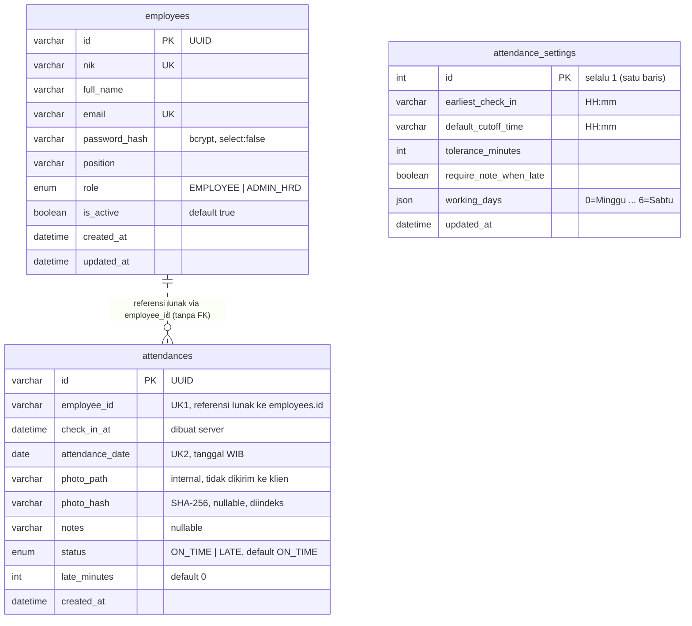
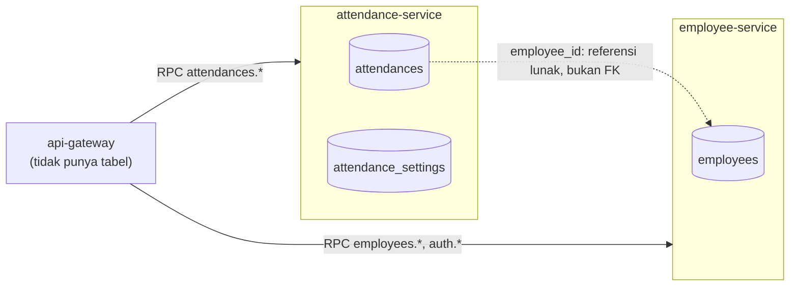

# ERD Absensi WFH

Dokumen ini disusun dari entity TypeORM yang ada:

- `employees` dari `apps/employee-service/src/employees/entities/employee.entity.ts`
- `attendances` dari `apps/attendance-service/src/attendances/entities/attendance.entity.ts`
- `attendance_settings` dari `apps/attendance-service/src/attendances/entities/attendance-settings.entity.ts`

Ketiga tabel berada di satu instance MySQL dan satu skema (`absensi_wfh`), tetapi dimiliki dua service berbeda.

> **Catatan penting: tidak ada foreign key lintas service.**
> Kolom `attendances.employee_id` berisi UUID dari `employees.id`, tetapi **tidak ada FK fisik** di database dan **tidak ada relasi TypeORM** (`@ManyToOne`/`@OneToMany`) antar entity. Hubungan ini hanya referensi lunak di level aplikasi. Penggabungan data (nama dan NIK karyawan pada daftar absensi, filter nama, ringkasan harian) dilakukan oleh `api-gateway` lewat RPC ke kedua service. Garis putus-putus pada diagram di bawah menandai referensi lunak ini.

## Diagram relasi entity

`attendance_settings` sengaja tidak punya relasi ke tabel mana pun: ia konfigurasi global (satu baris, `id = 1`), dibaca saat absen dibuat.

## Batas kepemilikan antar service

Aturan yang berlaku:

- Hanya `employee-service` yang membaca dan menulis `employees`; hanya `attendance-service` yang membaca dan menulis `attendances` dan `attendance_settings`.
- `attendance-service` tidak pernah melakukan `JOIN` ke `employees`. Jika membutuhkan data karyawan, gateway yang mengambilnya dari `employee-service`.
- Konsekuensi: database tidak mencegah `employee_id` yang tidak ada di `employees`. Integritas dijaga di level aplikasi (hanya karyawan yang lolos autentikasi yang bisa membuat absen) dan lewat soft delete (`is_active = false`), sehingga baris karyawan tidak pernah benar-benar hilang dan riwayat absensi tidak menjadi yatim.

## Kamus data

### `employees` (milik employee-service)

| Kolom | Tipe | Constraint | Keterangan |
|---|---|---|---|
| `id` | varchar(36) | PK | UUID, dibangkitkan otomatis |
| `nik` | varchar(30) | UNIQUE | |
| `full_name` | varchar(150) | | |
| `email` | varchar(150) | UNIQUE | |
| `password_hash` | varchar(100) | | Hash bcrypt; `select: false` sehingga tidak ikut terambil kecuali diminta eksplisit (saat login) |
| `position` | varchar(100) | | Jabatan |
| `role` | enum(`ADMIN_HRD`,`EMPLOYEE`) | default `EMPLOYEE` | |
| `is_active` | tinyint(1) | default 1 | `false` = soft delete, tidak bisa login |
| `created_at` | datetime | | |
| `updated_at` | datetime | | |

### `attendances` (milik attendance-service)

| Kolom | Tipe | Constraint | Keterangan |
|---|---|---|---|
| `id` | varchar(36) | PK | UUID |
| `employee_id` | varchar(36) | bagian dari `UQ_attendance_employee_date` | Referensi lunak ke `employees.id`, **tanpa FK** |
| `check_in_at` | datetime | | Waktu absen, dibuat server |
| `attendance_date` | date | bagian dari `UQ_attendance_employee_date`; indeks `IDX_attendance_date` | Tanggal kalender WIB, diturunkan dari `check_in_at` di server |
| `photo_path` | varchar(255) | | Nama berkas di folder `uploads/`; internal |
| `photo_hash` | varchar(64) | NULL; indeks `IDX_attendance_photo_hash` (tidak unik) | SHA-256 isi foto (heksadesimal); `NULL` untuk data sebelum fitur deteksi duplikat |
| `notes` | varchar(500) | NULL | Catatan karyawan |
| `status` | enum(`ON_TIME`,`LATE`) | default `ON_TIME` | Dihitung dan disimpan saat absen, tidak dihitung ulang saat pengaturan berubah |
| `late_minutes` | int | default 0 | Menit keterlambatan dari batas jam masuk dasar |
| `created_at` | datetime | | |

Constraint dan indeks:

- `UQ_attendance_employee_date` = `UNIQUE (employee_id, attendance_date)`: satu absen per karyawan per hari.
- `IDX_attendance_date` pada `attendance_date`.
- `IDX_attendance_photo_hash` pada `photo_hash`.

### `attendance_settings` (milik attendance-service)

| Kolom | Tipe | Keterangan |
|---|---|---|
| `id` | int, PK | Selalu `1` (konfigurasi satu baris; konstanta `ATTENDANCE_SETTINGS_ID`) |
| `earliest_check_in` | varchar(5) | Jam paling awal absen diperbolehkan, format `HH:mm` (WIB) |
| `default_cutoff_time` | varchar(5) | Batas jam masuk, format `HH:mm` (WIB) |
| `tolerance_minutes` | int | Toleransi keterlambatan (menit) |
| `require_note_when_late` | boolean | Catatan wajib jika terlambat |
| `working_days` | json | Array angka hari kerja, 0 = Minggu sampai 6 = Sabtu |
| `updated_at` | datetime | |

## Hal yang perlu diverifikasi

- **Presisi `datetime`.** Entity mendeklarasikan `datetime`, sedangkan handoff Fase 5B menulis `datetime(6)` untuk `employees.created_at` dan `updated_at`. Cek dengan `SHOW CREATE TABLE employees;` pada database yang berjalan.
- **Zona waktu penyimpanan `datetime`.** MySQL dijalankan dengan `--default-time-zone=+07:00` (lihat `docker-compose.yml`), tetapi konfigurasi koneksi TypeORM (`libs/common/src/database/typeorm.config.ts`) tidak termasuk dalam berkas yang ditempel, sehingga cara nilai `datetime` dikonversi *perlu diverifikasi*.
- **Baris awal `attendance_settings`.** Bahwa baris `id = 1` dibuat otomatis oleh attendance-service *perlu diverifikasi* di `attendance-settings.service.ts`.
- **Database lama.** Pada database yang dibuat sebelum Fase 5.5, kolom baru (`status`, `late_minutes`, `photo_hash`) dan tabel `attendance_settings` ditambahkan oleh `synchronize`. FK lama antara `attendances` dan `employees` pernah di-drop manual (handoff Fase 5B); verifikasi dengan `SHOW CREATE TABLE attendances;` bahwa tidak ada `FOREIGN KEY` tersisa.
