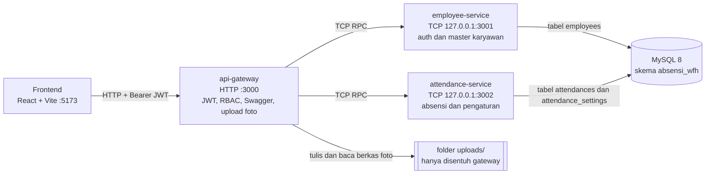
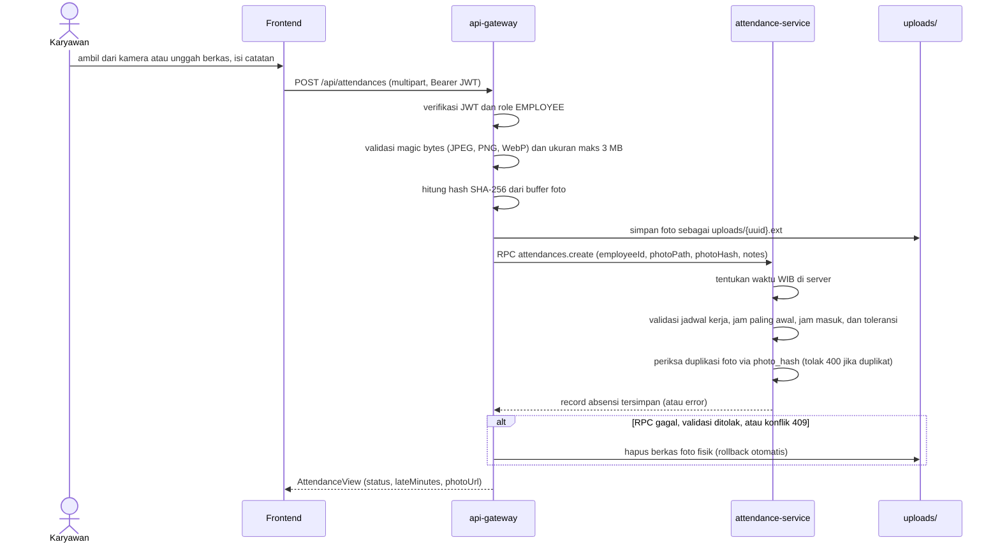

# Absensi WFH & Monitoring Karyawan

Aplikasi web untuk mencatat kehadiran karyawan yang bekerja dari rumah (WFH) dan memantaunya oleh tim HRD.

- **Karyawan** login, lalu absen satu kali per hari dengan bukti foto (bisa ambil langsung dari kamera via webcam atau unggah berkas gambar). Tanggal dan jam dicatat oleh server, bukan oleh perangkat karyawan.
- **Admin HRD** mengelola master karyawan (pencarian nama/NIK/email/jabatan, filter peran & status), mengatur jam masuk dan toleransi keterlambatan, memantau absensi (hanya lihat), melihat kartu ringkasan harian, memfilter berdasarkan status, dan mengekspor laporan ke CSV.

Zona waktu aplikasi: **Asia/Jakarta (WIB)**.

## Daftar isi

1. [Arsitektur](#arsitektur)
2. [Tech stack](#tech-stack)
3. [Prasyarat](#prasyarat)
4. [Menjalankan secara lokal dari nol](#menjalankan-secara-lokal-dari-nol)
5. [Akun demo](#akun-demo)
6. [Daftar endpoint](#daftar-endpoint)
7. [Keputusan desain dan alasannya](#keputusan-desain-dan-alasannya)
8. [Batasan yang diketahui dan rencana pengembangan](#batasan-yang-diketahui-dan-rencana-pengembangan)
9. [Skenario demo 5 menit](#skenario-demo-5-menit)
10. [Dokumen terkait](#dokumen-terkait)

## Arsitektur

Frontend hanya berbicara dengan **api-gateway** lewat HTTP. Dua service di belakangnya berkomunikasi lewat TCP (NestJS Microservices) dan hanya bind ke `127.0.0.1`, sehingga tidak terjangkau dari luar mesin.



Alur absen (`POST /api/attendances`):



Pembagian kepemilikan data:

| Komponen | Tanggung jawab | Tabel |
|---|---|---|
| `apps/api-gateway` | Satu-satunya pintu publik: CORS, helmet, validasi DTO, JwtAuthGuard dan RolesGuard, Swagger, upload dan streaming foto, penghitungan SHA-256 foto, orkestrasi lintas service (pencarian nama/jabatan, summary, export) | tidak ada |
| `apps/employee-service` | Login (bcrypt, penerbitan JWT), validasi status akun aktif, master karyawan | `employees` |
| `apps/attendance-service` | Transaksi absensi, status terlambat, deteksi duplikasi foto (SHA-256), pengaturan jam masuk, statistik harian | `attendances`, `attendance_settings` |
| `libs/common` | Enum, DTO, interface, utilitas waktu WIB, nama pola RPC, `AllRpcExceptionsFilter`, helper `sendRpc` | tidak ada |

## Tech stack

| Lapisan | Teknologi |
|---|---|
| Backend | TypeScript, NestJS 10 (monorepo, transport TCP), TypeORM, MySQL 8 |
| Auth | JWT (`@nestjs/jwt`, `passport-jwt`), password di-hash dengan bcrypt, role `EMPLOYEE` dan `ADMIN_HRD` |
| Validasi | class-validator dan class-transformer (`ValidationPipe` dengan `whitelist: true`) |
| Keamanan HTTP | helmet, CORS terbatas ke origin frontend (`FRONTEND_URL`) |
| Dokumentasi API | Swagger (`@nestjs/swagger`) di `/api/docs` |
| Frontend | React 18, Vite 5, TypeScript, Tailwind CSS 3, React Router 6, Axios, Radix UI (Dialog), lucide-react |
| Infrastruktur lokal | Docker Compose untuk MySQL 8 |

## Prasyarat

- **Node.js 20 LTS** dan npm.
- **Docker** dan Docker Compose (untuk MySQL 8).
- Port yang harus bebas: `3306` (MySQL), `3000` (gateway), `3001` dan `3002` (TCP internal), `5173` (frontend).

## Menjalankan secara lokal dari nol

Seluruh perintah dijalankan dari root repositori kecuali disebutkan lain.

### 1. Jalankan MySQL

```bash
docker compose up -d
docker compose ps        # tunggu sampai absensi-mysql berstatus healthy
```

`docker-compose.yml` berisi service `mysql` (image `mysql:8.0`, container `absensi-mysql`). Database `absensi_wfh`, user `absensi_user` dan zona waktu `+07:00` sudah diatur otomatis lewat compose.

### 2. Siapkan environment backend

```bash
cd backend
cp .env.example .env     # Windows PowerShell: Copy-Item .env.example .env
npm install
```

Variabel penting di `backend/.env` (nilai bawaan dari `.env.example`):

| Variabel | Bawaan | Keterangan |
|---|---|---|
| `GATEWAY_PORT` | `3000` | Port HTTP gateway |
| `FRONTEND_URL` | `http://localhost:5173` | Origin yang diizinkan CORS |
| `RPC_TIMEOUT_MS` | `5000` | Batas waktu panggilan RPC gateway ke service |
| `EMPLOYEE_SERVICE_HOST` / `_PORT` | `127.0.0.1` / `3001` | Alamat TCP employee-service |
| `ATTENDANCE_SERVICE_HOST` / `_PORT` | `127.0.0.1` / `3002` | Alamat TCP attendance-service |
| `UPLOAD_DIR` | `./uploads` | Folder foto bukti (dibuat otomatis oleh gateway saat startup jika belum ada) |
| `DB_HOST`, `DB_PORT`, `DB_NAME`, `DB_USER`, `DB_PASSWORD` | `127.0.0.1`, `3306`, `absensi_wfh`, `absensi_user`, `absensi_pass` | Sesuai `docker-compose.yml` |
| `DB_SYNCHRONIZE` | `true` | Skema dibuat otomatis oleh TypeORM |
| `JWT_SECRET` | contoh placeholder | String acak minimal 32 karakter |
| `JWT_EXPIRES_IN_SECONDS` | `28800` | Masa berlaku token (8 jam) |
| `BCRYPT_ROUNDS` | `10` | Biaya hash bcrypt |

### 3. Jalankan tiga service backend

Cara singkat (satu terminal, tiga proses via `concurrently`):

```bash
npm run start:dev
```

Atau satu terminal per service:

```bash
npm run start:employee     # TCP :3001
npm run start:attendance   # TCP :3002
npm run start:gateway      # HTTP :3000
```

Saat service pertama kali jalan, TypeORM membuat tabel (`DB_SYNCHRONIZE=true`). Baris default `attendance_settings` (`id = 1`) di-seed otomatis saat inisialisasi `attendance-service`. Pastikan log menampilkan `api-gateway listening on :3000`.

### 4. Isi data demo (seeder)

Buka terminal baru:

```bash
cd backend
npm run seed
```

Seeder (`apps/employee-service/src/database/seed.ts`) membuat akun demo dan bersifat idempoten (aman dijalankan berulang).

### 5. Jalankan frontend

```bash
cd ../frontend
npm install
npm run dev
```

Buka <http://localhost:5173>. Frontend memanggil `http://localhost:3000/api` secara bawaan. Untuk mengubahnya, buat `frontend/.env`:

```
VITE_API_URL=http://localhost:3000/api
```

### 6. Cek cepat

- `GET http://localhost:3000/api/time` mengembalikan waktu server (endpoint publik).
- Swagger: <http://localhost:3000/api/docs>.
- `api.http` di root berisi kumpulan request siap pakai (ekstensi VS Code *REST Client*).

#### Nilai default pengaturan absensi (`attendance_settings`, ID = 1)

Saat `attendance-service` dijalankan pertama kali, baris `id = 1` dibuat otomatis dengan konfigurasi default dari `DEFAULT_ATTENDANCE_SETTINGS` (terverifikasi sama pada database MySQL):

| Parameter | Kolom database | Nilai default | Keterangan |
|---|---|---|---|
| Jam paling awal | `earliest_check_in` | `00:00` | Absen dapat dilakukan mulai pukul 00:00 WIB |
| Batas jam masuk | `default_cutoff_time` | `08:00` | Batas masuk kerja dasar pukul 08:00 WIB |
| Toleransi keterlambatan | `tolerance_minutes` | `15` | Terlambat dihitung jika absen lewat 08:15 WIB |
| Wajib catatan jika terlambat | `require_note_when_late` | `false` (`0`) | Pengisian catatan bersifat opsional |
| Hari kerja | `working_days` | `[0, 1, 2, 3, 4, 5, 6]` | Berlaku setiap hari (Minggu s/d Sabtu) |

### Mereset data

```bash
docker compose down -v     # menghapus volume MySQL, lalu ulangi dari langkah 1
```

Hapus juga isi `backend/uploads/` (kecuali `.gitkeep`) agar bersih dari foto lama.

## Akun demo

| Peran | Email | Kata sandi |
|---|---|---|
| Admin HRD (`ADMIN_HRD`) | `admin@company.test` | `Admin123!` |
| Karyawan (`EMPLOYEE`) | `budi@company.test` | `Karyawan123!` |

## Daftar endpoint

Semua path berawalan `/api`. Autentikasi memakai header `Authorization: Bearer <accessToken>`. Format error standar: `{ "statusCode": number, "message": string | string[], "error"?: string }`.

| Method | Path | Role | Fungsi |
|---|---|---|---|
| GET | `/time` | Publik | Waktu server (WIB) untuk sinkronisasi jam di frontend |
| POST | `/auth/login` | Publik | Login, mengembalikan `accessToken`, `expiresIn`, `user` |
| GET | `/auth/me` | Semua user login | Profil user dari token |
| GET | `/employees` | ADMIN_HRD | Daftar karyawan (paginasi, `search` mencakup nama/NIK/email/jabatan, filter `role`, `isActive`, `position`) |
| POST | `/employees` | ADMIN_HRD | Tambah karyawan |
| GET | `/employees/:id` | ADMIN_HRD | Detail karyawan |
| PATCH | `/employees/:id` | ADMIN_HRD | Ubah karyawan (parsial) |
| DELETE | `/employees/:id` | ADMIN_HRD | Soft delete (`isActive = false`) |
| POST | `/attendances` | EMPLOYEE | Absen: multipart `photo` (wajib) dan `notes` (opsional, maks 500 karakter) |
| GET | `/attendances/today` | EMPLOYEE | Absensi hari ini, `null` jika belum absen |
| GET | `/attendances/my` dan `/attendances/me` | EMPLOYEE | Riwayat absensi sendiri (paginasi, filter tanggal) |
| GET | `/attendances/settings` | Semua user login | Baca pengaturan jam masuk |
| PATCH | `/attendances/settings` | ADMIN_HRD | Ubah pengaturan (parsial) |
| GET | `/attendances/summary` | ADMIN_HRD | Ringkasan harian (`?date=YYYY-MM-DD`, bawaan hari ini WIB) |
| GET | `/attendances/export` | ADMIN_HRD | Unduh CSV sesuai filter, maks 5.000 baris |
| GET | `/attendances` | ADMIN_HRD | Daftar absensi semua karyawan dengan filter dan paginasi |
| GET | `/attendances/:id/photo` | Pemilik absen atau ADMIN_HRD | Stream biner foto (`image/jpeg`, `image/png`, `image/webp`) |

### Parameter query untuk `GET /attendances` dan `GET /attendances/export`

Keduanya menggunakan DTO query yang sama (`QueryAttendancesDto` dan `ExportAttendancesQueryDto` di API Gateway). `GET /attendances` mendukung paginasi data, sedangkan `GET /attendances/export` tidak memakai paginasi (mengambil semua data yang cocok hingga batas 5.000 baris):

| Parameter | Tipe / Format | Bawaan | Keterangan |
|---|---|---|---|
| `dateFrom` | String (`YYYY-MM-DD`) | - | Tanggal awal filter (WIB). Alias kompatibilitas frontend: `date_from` |
| `dateTo` | String (`YYYY-MM-DD`) | - | Tanggal akhir filter (WIB). Alias kompatibilitas frontend: `date_to` |
| `search` | String (maks 100 karakter) | - | Pencarian nama atau NIK karyawan. Alias: `employee_name` |
| `employeeId` | String UUID | - | Filter ke satu karyawan tertentu |
| `status` | Enum (`ON_TIME` atau `LATE`) | - | Filter status keterlambatan absensi |
| `page` | Integer (min: 1) | `1` | Nomor halaman (hanya untuk `GET /attendances`) |
| `limit` | Integer (min: 1, maks: 100) | `10` | Jumlah baris per halaman (hanya untuk `GET /attendances`) |

### Catatan perilaku

1. **Perubahan Pengaturan (`PATCH /attendances/settings`):**
   - Mendukung pembaruan parsial (`UpdateAttendanceSettingsDto`). Field yang dikirim divalidasi ketat:
     - `earliestCheckIn`: Jam paling awal absen dibuka, format `HH:mm` 24 jam (`00:00` - `23:59` WIB).
     - `defaultCutoffTime`: Batas jam masuk kerja dasar, format `HH:mm` 24 jam (`00:00` - `23:59` WIB).
     - `toleranceMinutes`: Toleransi keterlambatan dalam menit (bilangan bulat 0 sampai 120).
     - `requireNoteWhenLate`: Boolean (`true` atau `false`), menentukan apakah catatan wajib diisi saat terlambat.
     - `workingDays`: Array angka hari kerja (`0` = Minggu s/d `6` = Sabtu). Minimal 1 hari (`ArrayMinSize(1)`), maksimal 7 hari (`ArrayMaxSize(7)`), dan tidak boleh duplikat (`ArrayUnique`).
2. **Ekspor CSV (`GET /attendances/export`):**
   - **Batas Baris:** Dibatasi maksimal 5.000 baris (`EXPORT_MAX_ROWS = 5000`).
   - **Header Respons:**
     - `Content-Disposition: attachment; filename="rekap-absensi-wfh-YYYY-MM-DD.csv"`
     - `X-Export-Truncated: true|false` (bernilai `true` jika data yang cocok di database melebihi 5.000 baris, diekspos lewat CORS agar dapat dibaca frontend).
   - **Format & Kolom CSV:** Kolom persisnya adalah `NIK, Nama Karyawan, Tanggal, Jam (WIB), Status, Keterlambatan (Menit), Catatan`.
   - **Format File:** Diawali UTF-8 BOM (`\uFEFF`) agar terbaca otomatis dengan rapi tanpa masalah karakter di Excel, dengan pemisah baris CRLF (`\r\n` sesuai RFC 4180).
   - **Sanitasi CSV Injection:** Seluruh nilai sel teks yang diawali karakter formula `= + - @ \t \r` secara otomatis dinetralkan dengan prefiks tanda kutip tunggal/apostrof `'` (`sanitizeCsvText` pada `csv.util.ts`) demi mencegah eksekusi formula berbahaya saat berkas dibuka di spreadsheet. Sel yang memuat koma, kutip dua, atau baris baru dibungkus tanda kutip ganda `"` dengan kutip di dalamnya digandakan (`""`).
3. **Ringkasan Harian (`GET /attendances/summary`):**
   - Populasi total (`totalEmployees`) hanya menghitung karyawan aktif ber-role `EMPLOYEE` (`findActiveStaff()`), akun `ADMIN_HRD` tidak dihitung.
   - Field yang dikembalikan (`AttendanceSummaryView`):
     - `date`: Tanggal summary (`YYYY-MM-DD` WIB, bawaan hari ini).
     - `totalEmployees`: Total karyawan aktif yang wajib absen.
     - `presentCount`: Jumlah karyawan yang sudah absen pada tanggal tersebut.
     - `onTimeCount`: Jumlah karyawan yang absen tepat waktu (`ON_TIME`).
     - `lateCount`: Jumlah karyawan yang absen terlambat (`LATE`).
     - `absentCount`: Jumlah karyawan yang belum absen (`totalEmployees - presentCount`).
     - `absentEmployees`: Daftar karyawan yang belum absen (`[{ id, fullName, nik }]`).

## Keputusan desain dan alasannya

1. **Waktu absen selalu dari server.** Gateway tidak menerima waktu dari klien. `attendance-service` membangkitkan `checkInAt` dan menurunkan `attendanceDate` (tanggal kalender WIB) di sisi server. Jam digital di halaman karyawan hanya tampilan yang disinkronkan ke `GET /api/time` (koreksi setengah RTT, sinkron ulang tiap 5 menit); stempel pada pratinjau foto berlabel "Pratinjau" dan bukan waktu resmi. Alasannya: jam perangkat klien mudah dimanipulasi, sedangkan catatan kehadiran harus akuntabel.
2. **Status terlambat disimpan saat absen.** Kolom `status` dan `late_minutes` dihitung dan ditulis permanen ketika absen dibuat, tidak dihitung ulang saat pengaturan berubah. Alasannya: riwayat absensi harus stabil dan mencerminkan aturan yang berlaku pada hari absensi terjadi.
3. **Pengaturan hanya berlaku ke depan.** Perubahan konfigurasi di `attendance_settings` hanya memengaruhi absensi baru berikutnya.
4. **Tanpa foreign key lintas service.** Kolom `attendances.employee_id` berisi UUID tanpa FK fisik ke `employees.id`, menjaga batas otonomi masing-masing service microservice. Penggabungan data dilakukan di gateway secara efisien (batch lookup via `findBriefsByIds` dan filter ID via `searchIds`).
5. **Foto dikelola terpusat di gateway.** Hanya `api-gateway` yang mengakses direktori `uploads/`. Service backend hanya menerima path berkas internal. Di frontend, foto diambil aman sebagai blob dengan token Bearer (`AuthedImage`, `useProtectedImage`).
6. **Validasi & Integritas Bukti Foto.** Gateway memverifikasi tipe berkas lewat magic bytes (JPEG, PNG, WebP) dan ukuran maksimal 3 MB. Rollback otomatis menghapus berkas foto fisik jika terjadi kegagalan RPC atau validasi ditolak.
7. **Deteksi Foto Duplikat (SHA-256).** Gateway menghitung hash SHA-256 dari setiap foto yang dikirim. `attendance-service` memverifikasi hash tersebut terhadap data absensi yang sudah ada di database. Jika ditemukan foto yang sama, sistem menolak dengan HTTP 400 (`BadRequestException`) dan pesan *"Foto ini sudah pernah digunakan. Ambil foto baru."*.
8. **Dual Mode Pengambilan Foto.** Di frontend, komponen `PhotoDropzone` menyediakan segmented control fleksibel: karyawan dapat mengambil foto langsung dari webcam (dengan hitung mundur dan optimasi JPEG) atau mengunggah berkas foto yang ada.
9. **Satu absen per hari.** Dijamin oleh constraint database `UNIQUE (employee_id, attendance_date)`. Usaha absen kedua menghasilkan konflik HTTP 409.
10. **Pencarian Master Karyawan Lengkap.** Mendukung pencarian kata kunci multi-field (Nama, NIK, Email, dan Jabatan) serta filter dropdown untuk Peran dan Status Keaktifan.

## Batasan yang diketahui dan rencana pengembangan

- **Tanpa check-out.** Aplikasi hanya mencatat jam masuk. Pengembangan: kolom `check_out_at` dan durasi kerja.
- **Tanpa jadwal shift, izin, dan cuti.** Hanya ada satu aturan jam masuk global plus `workingDays`. Karyawan yang izin akan tampil sebagai "Belum absen" pada kartu ringkasan, dan jam masuk tidak bisa berbeda per hari.
- **Isi foto tidak diverifikasi otomatis.** Server memeriksa tipe berkas, ukuran, dan duplikat (SHA-256), tetapi tidak memeriksa apakah foto benar-benar menampilkan karyawan yang sedang bekerja. Pengembangan: deteksi wajah dan liveness. HRD tetap bisa meninjau foto secara manual.
- **Kamera hanya berjalan di `localhost` atau HTTPS.** Jika frontend diakses lewat HTTP dari alamat IP jaringan, karyawan memakai unggah berkas.
- **Peran admin tingkat atas belum ada.** Semua `ADMIN_HRD` setara, termasuk dalam mengubah pengaturan absensi. Pengembangan: peran super admin dan log audit.
- **Docker Compose belum terpadu.** `docker-compose.yml` hanya menjalankan MySQL; backend dan frontend dijalankan lewat npm. Folder `uploads/` belum menjadi Docker volume.
- **Skema dibuat dengan `synchronize`.** Praktis untuk pengembangan, berisiko di produksi. Pengembangan: migrasi TypeORM.
- **Export dibatasi 5.000 baris.** Data lebih banyak terpotong dan ditandai header `X-Export-Truncated: true`.
- **Pencarian nama pada monitoring mencakup semua role**, tidak hanya karyawan.

## Skenario demo 5 menit

1. **0:00 (HRD):** Login sebagai `admin@company.test`. Buka **Master karyawan**, coba cari karyawan berdasarkan nama atau jabatan (mis. *"QA"* atau *"Engineer"*), lalu tambah satu karyawan baru: **Sari Demo** (`sari@company.test`, kata sandi `Karyawan123!`, NIK `2000000099`, jabatan `Staff Operasional`, role `EMPLOYEE`). Akun baru ini yang akan digunakan untuk demo absen (karena akun demo Budi mungkin sudah memiliki data absensi hari ini dari seed atau uji coba sebelumnya).
2. **1:00 (HRD):** Buka tab **Pengaturan absensi**. Atur batas jam masuk lebih awal dari jam saat ini (mis. 2-3 jam sebelum jam saat ini), aktifkan opsi **wajib catatan jika terlambat**, lalu simpan.
3. **1:45 (Karyawan):** Buka jendela penyamaran (*incognito*), login sebagai karyawan baru yang dibuat di langkah 1 (**`sari@company.test`** / `Karyawan123!`) — bukan Budi, untuk menghindari bentrok bila Budi sudah absen hari ini. Perhatikan jam digital tersinkron server dan keterangan batas jam masuk.
4. **2:15 (Karyawan - Sari Demo):** Ambil foto langsung dari kamera (webcam) atau unggah berkas, coba kirim tanpa catatan (ditolak karena catatan wajib jika terlambat), lalu isi catatan dan kirim. Absen berhasil dengan badge **Terlambat (+X mnt)**.
5. **3:00 (Karyawan - Sari Demo):** Coba absen kembali pada hari yang sama (ditolak dengan 409 Conflict: Anda sudah melakukan absensi hari ini).
6. **3:15 (HRD):** Kembali ke jendela HRD, buka **Monitoring absensi**. Periksa kartu ringkasan harian (Total Karyawan, Hadir, Tepat Waktu, Terlambat, Belum Absen) yang langsung ter-update dengan absensi Sari Demo.
7. **3:45 (HRD):** Gunakan filter status **Terlambat**, klik foto untuk memperbesar lewat dialog terproteksi.
8. **4:15 (HRD):** Klik **Export CSV**, berkas `rekap-absensi-wfh-YYYY-MM-DD.csv` terunduh dengan format rapi dan UTF-8 BOM.
9. **4:45 (HRD):** Akses dokumentasi interaktif Swagger di <http://localhost:3000/api/docs>.
10. **5:00 (HRD):** Kembalikan pengaturan jam masuk ke nilai semula.

## Dokumen terkait

- [`docs/erd.md`](docs/erd.md): ERD dan batas kepemilikan tabel antar service.
- [`api.http`](api.http): Koleksi request lengkap untuk ekstensi REST Client (VS Code).
- Swagger UI: `http://localhost:3000/api/docs` saat gateway berjalan.
